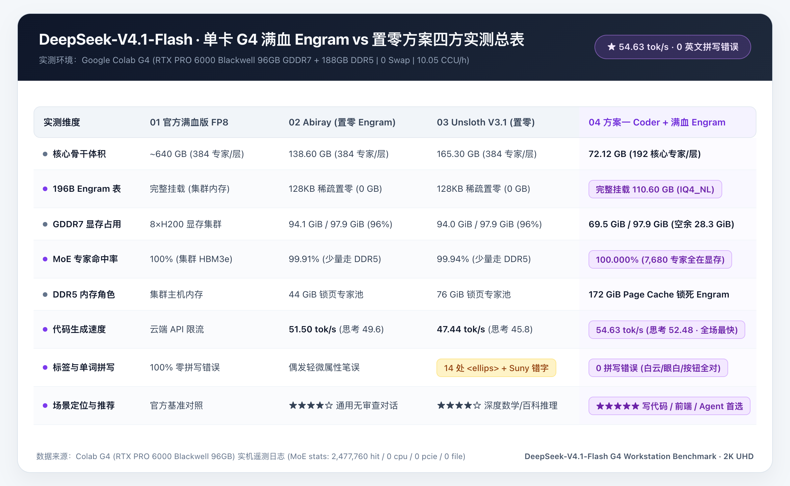

# 🚀 Google AI Ultra 云端算力工作站与智能调度技能 (Colab Ultra Workstation)

> **面向 AI Agent（Claude Code / Cursor / Codex / Antigravity / Windsurf）的零浏览器 Google Colab 云端 GPU 调度、748B 超大 MoE 推理与工业级 AI 影视生成工作站。**

[](#1-一键安装技能与核心工具链)
[_%7C_20x_(2000_CCU)-4285F4?style=flat-square&logo=google)](#2-智能硬件调度矩阵与防烧钱守门员)
[](#2-智能硬件调度矩阵与防烧钱守门员)
[](#1-一键安装技能与核心工具链)
[](https://opensource.org/licenses/MIT)

---

## 💡 为什么需要这个项目？

在使用 **Google AI Ultra（5x 套餐：`1,000 CCU/月 + 20TB 云盘`；20x 套餐：`2,000 CCU/月 + 30TB 云盘`）** 或 **Colab Pro+** 时，开发者常面临四大痛点：
1. **网页弹窗繁琐且易断连**：传统 `drive.mount` 每次重连都要点浏览器 OAuth 弹窗，网页空闲或隧道直连绕过 Jupyter 内核时极易被后台回收实例；
2. **FUSE 云盘读取龟速**：直接从 `/content/drive` `mmap` 读取百 GB 大模型仅 `~25 MB/s`（甚至触发 `112 GiB` 缓存墙掉到 `0.4 tok/s`），白白空烧高价显卡算力；
3. **选卡不当与幽灵计费**：开着 `10.05 CCU/h` 的 G4 去下模型、跑小任务，或任务结束后忘记销毁实例导致整夜扣费；
4. **长视频与超分成本失控**：多段视频接力容易起雾穿帮，盲目跑全幅 2K 扩散精修一次消耗近 `19 CCU`。

**`colab-ultra-workstation`** 将 [`google-colab-cli`](https://pypi.org/project/google-colab-cli/)、[`colab-dfs-ext`](https://github.com/deluxebear/colab-dfs-ext)（零浏览器静默挂载扩展）、[`colabllm`](https://github.com/deluxebear/colabllm)（标准化多模态服务编排）与 [`colab-mcp`](https://github.com/googlecolab/colab-mcp) 深度整合为一套标准化 **Agent Skill**，让本地 AI Agent 全自动完成 **按需选卡、零浏览器挂载 20TB/30TB 云盘、64 并发直灌本地 NVMe、10 分钟内核防休眠保活、二阶段精修成本门禁拦截，以及关机双轨 CCU 账单核验**。

---

## 📑 目录导航

1. [⚡ 快速开始：一键安装技能与核心工具链](#1-一键安装技能与核心工具链)
2. [🧠 智能硬件调度矩阵与防烧钱守门员](#2-智能硬件调度矩阵与防烧钱守门员)
3. [🐋 单卡 96GB G4 驯服 748B DeepSeek-V4.1-Flash（54.6 tok/s 满血 Engram + 原生视觉）](#3-单卡-96gb-g4-驯服-748b-deepseek-v41-flash546-toks-满血-engram--原生视觉)
4. [🎬 MiniMax-H3 (33B Native AV-DiT) 工业级影视与竖屏热舞工作流](#4-minimax-h3-33b-native-av-dit-工业级影视与竖屏热舞工作流)
5. [📦 仓库目录结构](#5-仓库目录结构)
6. [📚 核心技术白皮书与专项文档索引](#6-核心技术白皮书与专项文档索引)

---

## 1. 一键安装技能与核心工具链

### Step 1：安装 `colab-ultra-workstation` 技能

将本仓库克隆至全局 Agent 技能目录（Claude Code、Cursor、Codex、Antigravity 等均自动识别）：

```bash
git clone https://github.com/yuanyang749/colab-ultra-workstation.git ~/.agents/skills/colab-ultra-workstation
```

### Step 2：安装零浏览器 CLI 工具链（`google-colab-cli` + `colab-dfs-ext` + `colabllm`）

```bash
# 1) 安装官方 google-colab-cli (0.7.5+) 与 colab-dfs-ext（零浏览器静默挂载 20TB/30TB 云盘）
uv tool install --with socksio google-colab-cli
curl -fsSL https://raw.githubusercontent.com/deluxebear/colab-dfs-ext/main/install.sh | sh
colab dfs doctor

# 2) 安装 colabllm (0.1.2+) 与 Cloudflare cf CLI（一键拉起标准化多模态服务与公网安全隧道）
uv tool install colabllm
colabllm skill --output ~/.agents/skills
npm install -g cf --prefix ~/.local

# 3) [可选] 安装 colab-mcp（网页 Notebook 桥接通道，含 socksio 代理兼容修复）
uv tool install --with socksio --force git+https://github.com/googlecolab/colab-mcp
```

### Step 3：首次一次性 Google Drive OAuth 授权（永久免浏览器弹窗）

配合 `colab-dfs-ext` 只需在本地完成一次 OAuth 授权，后续所有云端实例均可秒级静默挂载 `/content/drive`，并由云端后台守护进程自动续期 Token：

```bash
# 开启本地代理时请显式传入 no_proxy="localhost,127.0.0.1"
https_proxy=http://127.0.0.1:7890 http_proxy=http://127.0.0.1:7890 no_proxy="localhost,127.0.0.1" colab dfs consent

# 验证签发的 Token 已包含 https://www.googleapis.com/auth/drive 作用域
https_proxy=http://127.0.0.1:7890 http_proxy=http://127.0.0.1:7890 colab dfs token

# 将默认 colab drivemount 自动路由至零浏览器 DFS 通道
grep -q 'COLAB_DFS_DEFAULT=1' ~/.zshrc || echo 'export COLAB_DFS_DEFAULT=1' >> ~/.zshrc
```

> [!IMPORTANT]
> **首次授权必看（Google OAuth 复选框陷阱）**：在浏览器弹出的 Google 授权确认页中，**「查看、编辑、创建和删除您的所有 Google 云端硬盘文件 (Google Drive)」** 旁边的复选框默认处于**未勾选**状态。请务必手动勾选后再点击「继续」；若漏勾导致挂载报 `403 ACCESS_TOKEN_SCOPE_INSUFFICIENT`，执行以下命令重签 `drive` 权限即可：
> ```bash
> python3 ~/.colab-dfs-ext/colab_dfs_ext/dfs_creds.py consent --flavor dfs --scopes "https://www.googleapis.com/auth/drive" --user-id <GaiaId> --email <Email>
> ```

### Step 4：日常高频运维速查表

| 场景分类 | 常用命令 | 说明 |
| :--- | :--- | :--- |
| **按需开机** | `colab new -s work` | 启动 **免费 CPU (`0.00 CCU/h`)**，专用于预下载模型与整理云盘 |
| **指定 GPU** | `colab new -s work --gpu G4` | 启动 **G4 (`96GB Blackwell, 10.05 CCU/h`)**（可选 `L4` / `T4` / `A100` / `H100`） |
| **跑完即焚** | `colab run task.py --gpu G4` | 创建临时 GPU 跑完脚本后立即自动销毁释放实例 |
| **静默挂盘** | `colab dfs mount -s work` | 零浏览器秒级挂载 `/content/drive`（加 `--readonly` 开启只读防误删保护） |
| **掉盘自愈** | `colab dfs mount -s work --force --purge-state` | FUSE 假死原地抢救重挂（无需重启 GPU 实例） |
| **计费打点** | `python3 scripts/colab_meter.py start -s work -g G4` | 任务启动前记录精确时间戳与初始 CCU 余额 |
| **关机核验** | `colab stop -s work && python3 scripts/colab_meter.py stop -s work` | 销毁实例并输出双轨 CCU 消耗结算单（确认 `Active assignments: 0`） |

---

## 2. 智能硬件调度矩阵与防烧钱守门员

### 2.1 视频生成、大语言模型 (LLM) 与多模态服务选卡矩阵

| 任务分类 | 推荐硬件档位 | 硬件规格 | 费率 (`CCU/h`) | 月度续航 (`5x` / `20x`) | 适用负载与调度准则 |
| :--- | :--- | :--- | :--- | :--- | :--- |
| **模型下载 / 预处理** | **`CPU`** | Host CPU | **`0.00`** | ♾️ 无限 | **严禁开高价 GPU 从 HF 首次下载几十 GB 模型**；检测到 `>= 5 CCU/h` 自动拦截 |
| **轻量推理 (`llm_small`)** | **`T4 GPU`** | 15 GB GDDR6 | **`1.19`** | ~840h / ~1,680h | `1.5B ~ 9B` LLM 4-bit 量化推理、`ollama` 轻量服务 |
| **高性价比主力 (`light_video` / `llm_medium`)** | **`L4 GPU`** | 22.5 GB GDDR6<br>Ada (`sm_89`) | **`1.71`** | ~584h / ~1,169h | `Wan2.1-1.3B`、`Flux`、`Qwen3-TTS`、`IndexTTS-2`、`14B` FP8 推理/微调、`32B` Q4 极限卡位 |
| **批量文档 OCR** | **`A100 GPU`** | 40/80 GB HBM2e | **`8.71`** | ~115h / ~230h | `colabllm unlimited-ocr`（大批量 PDF/图片转 Markdown 断点续传） |
| **旗舰王炸 (`heavy_video` / `llm_ultra_moe`)** | **`G4 GPU`** | **96 GB GDDR7**<br>RTX PRO 6000 Blackwell (`sm_120a`) + **188 GB DDR5** | **`8.71 ~ 10.05`** | ~100h / ~200h | **全面替代 A100/H100**！拥有 `1 PFLOPS BF16 / 2 PFLOPS FP8 / 4 PFLOPS FP4`：<br>• **`MiniMax-H3 (33B + 32B VLM)`** 全量常驻显存（零 CPU Offload）<br>• **`748B DeepSeek-V4.1-Flash`** 单卡零 Swap 达 **`54.63 tok/s`**<br>• **`Qwen3.8-Flash-Next`** `800K` 超长上下文 + 原生 `BF16` 视觉 (`colabllm qwen-flash`) |
| **极致单流带宽** | **`H100 GPU`** | 80 GB HBM3 | **`18.05`** | ~55h / ~110h | 仅当总显存需求 `< 75GB` 且追求极致 HBM3 带宽时选用（日常优先用 **G4**） |

### 2.2 跨档位防浪费与防断连五大铁律（Zero-Burn & Anti-Idle Core Rules）

1. **本地 `0 CCU` 备料铁律**：所有分镜提示词编排、配置文件修改、首帧锚点图裁切与音频鼓点切片必须在启动云端 GPU 前在本地完成。
2. **视频二阶段「精修 / 2K 超分」强制交互确认门禁（Mandatory Refinement Gate）**：
   - 当用户提出“精修”、“超分”或“2K 高清化”时，**Agent 严禁直接开机或默认跑高耗全幅精修**，必须先向用户提问展示以下 5 档方案的耗时与 CCU 预估，等用户确认后再传入 `--profile <scheme>` 执行：
     - `local_cas`（**推荐首选，`0.00 CCU`，~25 秒**）：本地 Mac `Lanczos + FidelityFX CAS` 自适应锐化 2K，100% 保留原生肤质；
     - `local_esrgan`（**`0.00 CCU`，~2.5 分钟**）：本地 Mac GPU `Real-ESRGAN + CAS` 45:55 混合 2K 神经超分；
     - `g4_turbo_face`（**30s 约 `2.0 CCU` / ~12 分钟，省 89% 算力**）：云端 G4 仅重绘上半身与脸部 `Tile 0 (1536×1088)` + `124 帧` 单窗直出（共 6 轮采样）；
     - `g4_fast_face`（**30s 约 `5.8 CCU` / ~34 分钟，省 69% 算力**）：云端 G4 仅重绘上半身与脸部 `Tile 0` + `56 帧` 时序滑窗（共 18 轮采样）；
     - `g4_optimal`（**30s 约 `18.75 CCU` / ~102 分钟**）：云端 G4 上/中/下 3 分块 × `56 帧` 滑窗全画幅重采样（共 54 轮采样，仅限最终母带定稿）。
3. **三路全并发直灌本地 NVMe（破除 FUSE 限速墙）**：严禁在 `/content/drive` 直接 `mmap` 大模型；一律通过 64 并发 Google Drive v3 API 流（`~150 MB/s`）与 HuggingFace CDN（`~400 MB/s`）直灌本地 Gen5 NVMe（`/content/fast_*`）。
4. **10 分钟 Jupyter 内核防休眠保活守护进程（`colab_keepalive_<session>`）**：
   - 当通过 Cloudflare Tunnel 调用后台端口（如 `:18150 -> :8150`）时，推理流量会绕过 Colab 的 `ipykernel`，导致连续 30~60 分钟后被看门狗误判为空闲回收。[`scripts/deepseek_g4/fast_start_g4.sh`](scripts/deepseek_g4/fast_start_g4.sh) 在启动时自动挂载本地后台心跳进程，每 10 分钟向内核发送一次轻量握手，并在 `stop` 时自动清理。
5. **关机落盘校验与强制双轨 CCU 结算**：每次销毁实例前自动校验 Google Drive 产物 `size > 0`，并通过 [`scripts/colab_meter.py`](scripts/colab_meter.py) 输出双轨计费核验报告（确认 `Active assignments: 0` 且速率归零 `0.00 CCU/h`）。

---

## 3. 单卡 96GB G4 驯服 748B DeepSeek-V4.1-Flash（`54.6 tok/s` 满血 Engram + 原生视觉）

本仓库在 [`scripts/deepseek_g4/`](scripts/deepseek_g4/) 中提供了在单张 **Colab G4 (`96GB GDDR7 + 188GB DDR5 + Gen5 NVMe`)** 上零磁盘 Swap 运行 **748B `DeepSeek-V4.1-Flash-1017`** 的完整工程实现，配套两篇深度实测报告：
- **第三弹（三级混合零 Swap 架构与 Engram 置零「提笔忘字」病理实证）**：[`references/deepseek_v41_748b_g4_guide.md`](references/deepseek_v41_748b_g4_guide.md)
- **第四弹（72.1GB 全显存骨干 + 110.6GB 满血 Engram 实测破案 & 四大版本 2×2 同屏对决）**：[`references/deepseek_v41_g4_ep4_full_engram_guide.md`](references/deepseek_v41_g4_ep4_full_engram_guide.md)



### 3.1 三大 2-Bit 旗舰方案实测对比与选型表

| 方案代号 (`--variant`) | 模型组成（骨干网 + Engram + 视觉头） | G4 显存 / 内存驻留分布 | 解码速度 (`tok/s`) | 代码拼写 / 标签准确率 | 推荐场景 |
| :--- | :--- | :--- | :--- | :--- | :--- |
| **`ista-coder-iq2xxs`** *(代码与 Agent 首选)* | `ISTA-DASLab GSQ-RCO-Coder` (`72.12 GB` 192 专家剪枝主干) + **`110.60 GB` 完整 `IQ4_NL` Engram** + 可选 `972MB mmproj-BF16` | **7,680 个专家 100.000% 锁死 GDDR7 显存 (`69.5 GiB`)** + `110.6 GB` Engram 100% 锁死 DDR5 内存 (`0 PCIe / 0 Swap`) | **`54.63 tok/s`** *(全场最快)* | **100% 零拼写错误**（彻底根治 `<ellips>` 与单词断字） | 日常主力写代码、前端 SVG/UI 生成、多模态看图写代码 (`--vision`) |
| **`unsloth-ud-iq2xxs`** *(全专家百科推理)* | `Unsloth Dynamic V3.1 UD-IQ2_XXS` (`165.30 GB` 552B 全专家主干) + `128 KB` 稀疏 Engram 头 | 71% 活跃专家 (`~87.2 GiB`) 锁显存 + 29% 冷门专家锁 DDR5 内存 (`--arena-gib 76`) | `47.40 tok/s` | 数学/逆运动学极强，偶发标签漏字母 | 115K 超长代码库全局重构、冷门通识与深度数学推导 |
| **`abiray-gsq-iq2xxs`** *(无审核极速创意)* | `Abiray Uncensored GSQ-RCO IQ2_XXS` (`138.59 GB` 破限全专家主干) + `128 KB` 稀疏 Engram 头 | 83% 专家锁显存 + 17% 专家锁 DDR5 内存 | `51.50 tok/s` | 审美与光影构图极佳 | 创意写作、无限制角色扮演、赛博视觉特效生成 |


### 3.2 四条命令全生命周期操控（`scripts/deepseek_g4/fast_start_g4.sh`）

```bash
# 1. 启动代码首选方案（72.1GB 主干全显存 + 110.6GB 完整 Engram 全内存 + 5ms 原地 Header 补丁 + 10分钟防休眠保活）
./scripts/deepseek_g4/fast_start_g4.sh start --variant ista-coder-iq2xxs

# 2. 开启原生 BF16 视觉多模态（挂载 972.2MB mmproj-BF16.gguf，支持直接发 UI 截图/报错图生成代码）
./scripts/deepseek_g4/fast_start_g4.sh start --variant ista-coder-iq2xxs --vision

# 3. 保持 :8150/v1 网关不断连，22 秒热切换至全专家变体或查看实时遥测状态
./scripts/deepseek_g4/fast_start_g4.sh switch abiray-gsq-iq2xxs
./scripts/deepseek_g4/fast_start_g4.sh status

# 4. 下班一键销毁 G4 实例与本地保活守护进程，确认回归 0.00 CCU/h
./scripts/deepseek_g4/fast_start_g4.sh stop
```

---

## 4. MiniMax-H3 (33B Native AV-DiT) 工业级影视与竖屏热舞工作流

本仓库在 **G4 (`96GB Blackwell`)** 上实现了 `MiniMax-H3 (33B)` + `Qwen3-VL-32B-Heretic NVFP4` 全量显存常驻（零 CPU Offload，预留 `49GB` 纯激活值显存空间），并将不同影视制作场景隔离为 `workflows/` 下的四大独立工作流包：

### 4.1 四大独立场景工作流包（`workflows/`）

| 工作流目录 | 适用场景与画幅 | 核心技术特性与一键执行入口 |
| :--- | :--- | :--- |
| **[`01_dialogue_2p_photorealistic/`](workflows/01_dialogue_2p_photorealistic/)** | **16:9 横屏 · 真人写实双人多镜头连续对手戏** | • 40 行 [`drama_config.json`](workflows/01_dialogue_2p_photorealistic/drama_config.json) 零门槛配置男女主定妆照、声纹与台词<br>• **`H3SaveAVLatent / H3LoadAVLatent` (`~4.8 MB`)**：支持 `--only-seg N` 在 **3 分钟内（省 75% CCU）** 单段无损补拍<br>• **`V9_TailLock` 首尾双端潜空间夹具** + **`Self-Anchor Voice` 原生自锚定声纹** + **`T8mars` (`+8.2 dB`) 情绪爆发协议** |
| **[`02_action_mma_combat/`](workflows/02_action_mma_combat/)** | **16:9 横屏 · 武指级 15s 一镜到底格斗动作戏** | • **`V3 ProSeam` 武指暗切五法则**：上半段结尾设计正蹬踹退制造 `1.5m` 物理分离呼吸点（`join_match=0.1243`，肉眼 0 接缝）<br>• **`V6 BrowStrike` 同源战损定妆切换**：高位拳峰落点与左眉弓裂口 100% 物理对齐 |
| **[`03_dance_choreography/`](workflows/03_dance_choreography/)** | **通用长镜头舞蹈与多关键帧序列补间** | • 基于 `MiniMaxH3AddGuide` 按 **`frame_idx = 17k` (`0, 34, 51, 85, 136, 170`)** 串联钉入独立关键帧，实现确定性动作补间 |
| **[`04_douyin_beauty_dance/`](workflows/04_douyin_beauty_dance/)** | **9:16 竖屏 · 抖音/TikTok 30s 1:1 偶像热舞与多档位 2K 精修套件** | • **双图视觉权威 (`<Picture 1>` 全身 + `<Picture 2>` 腰上中近景)** + **零外貌累赘提示词** + **1:1 摄影机同步推拉**<br>• 默认内置 **30s 四段式（`702 帧 @ 24fps = 29.25s`）1:1 X 原片编舞** 与 **2,767 行动作链标准件库 (`dance-motion-chain-h3.md` Rev.1.4)**<br>• 配套 [`open_dance_bgm_kit/`](workflows/04_douyin_beauty_dance/open_dance_bgm_kit/) 开源舞曲（FineDance / AIST++）无损拼接与 BPM 鼓点测算套件<br>• 二阶段 [`run_tessera_2k.py`](workflows/04_douyin_beauty_dance/run_tessera_2k.py) 内置 **强制交互确认门禁**，支持本地 `0 CCU` (`local_cas` / `local_esrgan`) 与云端 `g4_turbo_face` / `g4_fast_face` / `g4_optimal` 按需切换 |

### 4.2 独立云端双引擎 TTS 语音工作站 & 本地 `0 CCU` 自动字幕

- **云端双擎 TTS（[`scripts/launch_cloud_tts_studio.py`](scripts/launch_cloud_tts_studio.py) + [`scripts/run_cloud_tts_remote.py`](scripts/run_cloud_tts_remote.py)）**：
  - 零 ComfyUI 依赖，无需拉取 42GB 视频权重；将 **`Qwen3-TTS-12Hz-1.7B` (`VoiceDesign` + 基频守卫 $F_0$ Pitch Guard)** 与 **B站 `IndexTTS-2` (8 维情感向量 `emo_vector` 解耦)** 同时常驻显存，单句重跑仅需 **~2.5 秒**。
- **本地 `0 CCU` 声学包络对齐字幕与动效铭牌（[`scripts/auto_subtitle_video.py`](scripts/auto_subtitle_video.py)）**：
  - 自动分析每段人声包络起止点与句中换气停顿（10ms 精度，自动过滤拍桌脉冲），一键生成 `.srt` 外挂字幕、带 `0.38s` 淡入淡出微动效的人物出场毛玻璃铭牌及 2 倍超采样电影级内嵌硬字幕。

---

## 5. 仓库目录结构

```text
colab-ultra-workstation/
├── README.md                                          # 仓库主文档（架构总览、快速开始与全模块导航）
├── SKILL.md                                           # Agent 核心技能定义（硬件调度矩阵、SOP 与防烧钱门禁）
├── references/                                        # 深度技术白皮书与标准作业程序 (SOP)
│   ├── deepseek_v41_748b_g4_guide.md                  # [第三弹] 单卡 96GB G4 跑通 748B DeepSeek-V4.1 零 Swap 与 Engram 置零病理实证
│   ├── deepseek_v41_g4_ep4_full_engram_guide.md       # [第四弹] 72.1GB 全显存骨干 + 110.6GB 满血 Engram 54.6 tok/s 四大版本 2×2 终极横评
│   ├── minimax_h3_zero_waste_sop.md                   # MiniMax-H3 视频生成、双擎 TTS、潜变量续跑与二阶段精修门禁 SOP (铁律 A~H)
│   ├── minimax_h3_industrial_workflow_whitepaper.md   # MiniMax-H3 工业级写实长视频与多角色一致性全链路架构白皮书 (v2.5)
│   └── minimax_h3_uncensored_comfyui_guide.md         # MiniMax-H3 无审核破限版 + Turbo 加速 + ComfyUI 高阶实战避坑指南
├── scripts/                                           # 云端自动化调度、计费核验与专项工程脚本
│   ├── deepseek_g4/                                   # 748B DeepSeek-V4.1-Flash 单卡 G4 自动化套件
│   │   ├── README.md                                  # DeepSeek-V4.1 G4 四步流水线与命令手册
│   │   ├── fast_start_g4.sh                           # 一键启动 / 10分钟防休眠保活 / 多变体热切换 / Caddy 双模鉴权 / 停机释放
│   │   ├── step1_cpu_download_to_drive.py             # [0 CCU/h 免费 CPU] 预下载 2-bit 主干分片与 Engram 至 Google Drive
│   │   ├── step2_g4_build_engines.sh                  # 编译 Blackwell sm_120a 原生 Delta Engine + llama.cpp 并打包 2 秒解压归档
│   │   ├── step3_g4_hybrid_stage_and_benchmark.py     # 64 并发 Drive-v3/HF 直灌 NVMe + Header 补丁 + 内存腾笼换鸟 + OpenAI/Caddy 网关
│   │   ├── run_pelican_benchmark.py                   # Simon Willison「鹈鹕骑自行车」交互式 SVG+JS 基准测试脚本
│   │   └── examples/                                  # 方案一 (ISTA-Coder+满血Engram)、Unsloth UD 与 Abiray GSQ 实测生成 HTML 源码
│   ├── colab_meter.py                                 # 开机打点 + 停机双轨 CCU 计费核验与幽灵实例强杀工具
│   ├── launch_g4_comfyui_fast.py                      # G4 96GB 三路全并发 (Drive API + HF CDN + 单包解压) NVMe 极速冷启动引擎
│   ├── resume_from_latent_checkpoint.py               # 分段原生潜变量 (SaveLatent/LoadLatent) 快照注入与零损耗断点续跑生成器
│   ├── auto_subtitle_video.py                         # 声学包络自动对齐电影级字幕 (SRT/内嵌) + 人物出场动效铭牌压制工具
│   ├── launch_cloud_tts_studio.py                     # 独立云端双擎 TTS (Qwen3-TTS + IndexTTS-2) 常驻合成服务
│   ├── run_cloud_tts_remote.py                        # 本地遥控云端 TTS 极速合成与音频回传脚本
│   ├── setup_minimax_h3_comfyui.py                    # 0 CCU/h 免费 CPU 全自动部署 ComfyUI 与核心模型权重脚本
│   └── mcp_dfs_mount.py                               # colab-mcp 零浏览器挂载载荷一键生成器（含 Token 凭证自动擦除）
├── workflows/                                         # 按场景隔离的 MiniMax-H3 独立工作流包
│   ├── 01_dialogue_2p_photorealistic/                 # 场景 01：16:9 真人写实双人多段连续对手戏 (含 drama_config.json 与单段热插拔)
│   ├── 02_action_mma_combat/                          # 场景 02：16:9 武指级 15s 一镜到底 MMA 格斗与同源战损切换
│   ├── 03_dance_choreography/                         # 场景 03：通用长镜头舞蹈与 17k 关键帧序列控制
│   └── 04_douyin_beauty_dance/                        # 场景 04：9:16 竖屏 30s 1:1 抖音热舞 + 多档位 2K 精修 + 开源舞曲套件
│       ├── README.md                                  # 竖屏热舞核心五大铁律与二阶段精修门禁说明
│       ├── dance_config.json                          # 30s 四段式 1:1 X 原版编舞与二阶段 5 档精修配置文件
│       ├── run_dance.py                               # 一阶段：云端 G4 极速执行器（支持 8s/15s/30s 动态时长与鼓点对齐）
│       ├── run_tessera_2k.py                          # 二阶段：带强制交互确认门禁的本地/云端多档位 2K 精修执行器
│       ├── upscale_local_mac_2k.py                    # 二阶段（本地 0 CCU）：Mac Apple Silicon 原生 CAS / Real-ESRGAN+CAS 混合 2K 超分
│       ├── open_dance_bgm_kit/                        # 开源舞曲库（FineDance / AIST++）无损下载与鼓点分析工具包
│       └── references/dance-motion-chain-h3.md        # 2,767 行完整动作链标准件库（Rev.1.4，含 A宅舞/B抖舞/C古风/E运镜/K扩展包）
├── assets/
│   └── deepseek_v41_g4/                               # 748B DeepSeek-V4.1 G4 架构图、四大版本评测总表与同屏对比视频
├── templates/
│   └── workstation_init.py                            # 云端常驻硬件探测、配额校验与防烧钱下载器模块
├── notebooks/
│   └── Google_AI_Ultra_Workstation.ipynb              # 完整实测 Colab 工作站交互式记事本
└── skills/
    └── colab-ultra-workstation/                       # 标准 Skill 目录镜像（供打包分发）
```

---

## 6. 核心技术白皮书与专项文档索引

| 文档路径 | 适用读者与查阅场景 |
| :--- | :--- |
| **[`SKILL.md`](SKILL.md)** | AI Agent 自动加载的主技能规范（选卡矩阵、零浏览器挂载 SOP、10 分钟保活与 `colabllm` 协同） |
| **[`references/deepseek_v41_g4_ep4_full_engram_guide.md`](references/deepseek_v41_g4_ep4_full_engram_guide.md)** | 想在单卡 96GB G4 上以 **`54.63 tok/s` + 0 拼写错误** 跑通 `72.1GB` 代码主干 + `110.6GB` 满血 Engram + 原生视觉 + Caddy 鉴权 |
| **[`references/deepseek_v41_748b_g4_guide.md`](references/deepseek_v41_748b_g4_guide.md)** | 深入了解 748B MoE 三级混合零 Swap 架构，以及「552B 骨干网 vs 196B Engram」第一性原理解剖 |
| **[`references/minimax_h3_zero_waste_sop.md`](references/minimax_h3_zero_waste_sop.md)** | 运行 `MiniMax-H3` 必读的 **八大零浪费铁律（铁律 A ~ H）**，涵盖 `F = 17k + 5` 帧数表、双擎 TTS、潜变量续跑与二阶段精修门禁 |
| **[`references/minimax_h3_industrial_workflow_whitepaper.md`](references/minimax_h3_industrial_workflow_whitepaper.md)** | 深入了解 22 帧潜空间接力、`H3 Join Match` 手动防起雾参数、`Self-Anchor Voice` 与 `V3 ProSeam` 武指分镜语法 |
| **[`workflows/04_douyin_beauty_dance/README.md`](workflows/04_douyin_beauty_dance/README.md)** | 制作 9:16 竖屏 15s/30s 抖音热舞视频、使用 `2,767` 行动作链库或执行本地/云端 2K 超分 |
| **[`workflows/01_dialogue_2p_photorealistic/README.md`](workflows/01_dialogue_2p_photorealistic/README.md)** | 使用 40 行 JSON 零门槛制作双人写实短剧对手戏与 `--only-seg N` 单段 3 分钟快速补拍 |

---

## 📄 License

MIT License © [yuanyang749](https://github.com/yuanyang749)
