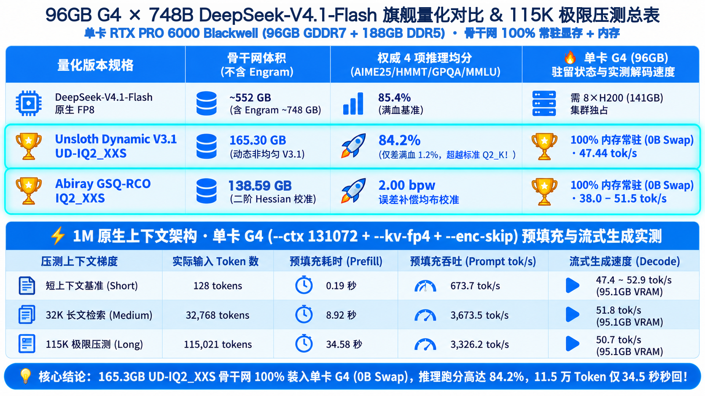
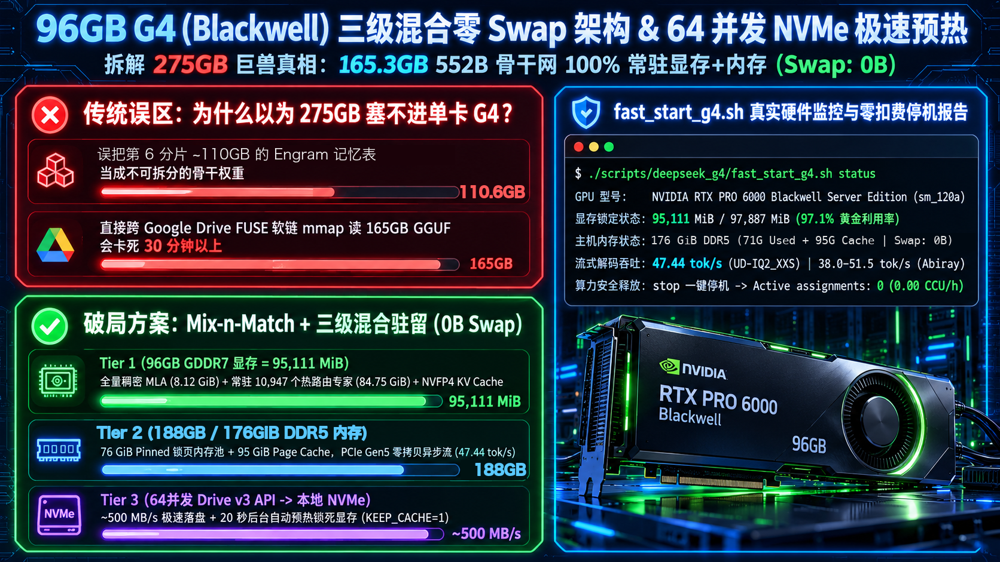
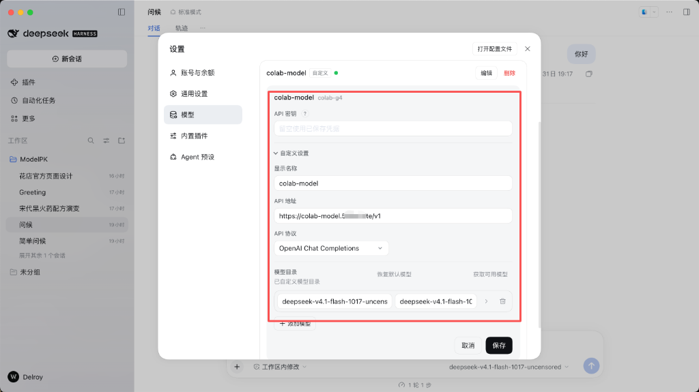
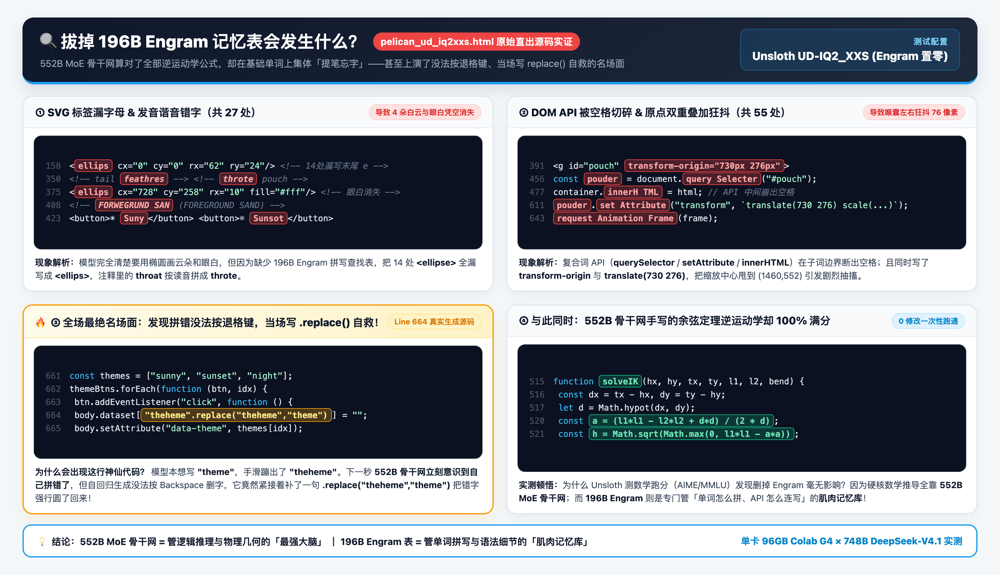

# 把 Google AI Ultra 1000 CCU 榨出双倍价值（第三弹）：用单卡 96GB G4 跑通 748B DeepSeek-V4.1 折腾实录


前两篇发完之后，不少朋友跟着把 Google Drive 20TB 云盘挂上了，也用 Colab 新出的 **G4 实例（RTX PRO 6000 Blackwell，96GB 显存，现在实时费率涨到了每小时 `10.05 CCU`）** 跑通了 33B 的视频模型。

这几天我一直在琢磨另一件事：**既然 G4 有 96GB 显存，再加上机器自带的 188GB DDR5 内存（`free -h` 显示 176 GiB），我能不能干脆在单张卡上把刚开源的 `DeepSeek-V4.1-Flash-1017`（总参数 748B）跑起来，当成我自己的私人不限速 API 用？**

说实话，刚开始看文件体积我是有点发怵的。满血 FP8 要七百多 GB 就不提了，哪怕是压到 2-bit 的 `IQ2_XXS` 量化版，HuggingFace 仓库里标出来的总大小也有 **215GB 到 275GB**。G4 本地硬盘才 200GB 出头，要是直接从云盘挂载硬跑，每蹦一个字都要狂读硬盘，速度不到 `0.5 tok/s`，根本没法用。

折腾了几天之后，我终于摸清了它的分片套路，把整个模型塞进了 G4 的「显存 + 内存」里，做到了 **0 磁盘 Swap、每秒 47～52 个 Token** 的丝滑输出，还顺手把社区最火的两个 2-bit 量化版本（**Unsloth 版** 和 **Abiray 版**）拉出来遛了一圈。这篇就用大白话记录一下我的实际测试过程和踩过的坑。



> **⚡ 先放我实测下来的几个核心结论：**
> 1. **不用被 275GB 吓到，核心权重其实只有 165GB（但写代码千万别把 Engram 置零！）**：看懂文档后我才发现，748B 里负责思考和写代码的 552B 骨干网（前 5 个分片）只有 **`165.3 GB`**（Abiray 版更是只有 **`138.6 GB`**），能全部塞进 G4 的 **96GB 显存 + 188GB 内存**。我这次测试为了省本地硬盘空间，把 196B 的 Engram 查找表置零跑完了全程；但从第四章鹈鹕骑车的源码实测来看，**Engram 置零会导致严重的「提笔忘字」拼写 Bug，日常写代码还是不能置零**——我在第四章末尾补上了在单卡 G4 上挂载完整 Engram 的 3 个落地方案。
> 2. **生成速度够快，长文也不卡**：平时聊天写代码稳定在 **`47 ~ 52 tok/s`**（首字响应 2 秒左右）；模型原生支持 1M 上下文，我在 G4 上开了 128K 窗口，实测塞进去 **11.5 万 Token** 的代码库，**34 秒**就开始往外蹦字了。
> 3. **一套权重、两种人设**：我写了个小网关，不多占显存，在客户端里同时刷出 `standard` 和 `uncensored` 两个模型名（本质是同一份权重配不同的系统提示词），通过 Cloudflare 固定隧道直接连到本地桌面端用。

---

# 一、我是怎么把 748B 塞进单卡 G4 的？

## 1. 拆包才发现的真相：前 5 个分片才是本体

我最开始去下 `Unsloth Dynamic V3.1 UD-IQ2_XXS` 的时候，看到总大小 **275 GB** 差点放弃。后来仔细翻了翻 [Unsloth 官方文档](https://unsloth.ai/docs/models/deepseek-v4.1-flash) 和 GGUF 分片列表，才搞明白 DeepSeek-V4.1 的真实结构：

- **前 5 个分片（00001 ~ 00005）**：这是 **552B 的 MoE 核心骨干网**，加起来其实只有 **`165.30 GB`**（如果用 Abiray 的 `GSQ-RCO IQ2_XXS` 版本，4 个分片更是只有 **`138.59 GB`**）；
- **第 6 个分片（00006）**：剩下的 **约 110 GB** 全是一个叫 **Engram（196B 记忆查找表）** 的附加表（`IQ4_NL` 版是 `110.6 GB`），Unsloth 官方文档也写了 Engram 可以单独混搭（Mix-and-Match）。

搞清楚这点之后，账一下就算过来了：G4 有 **96GB 显存 + 188GB 内存**，装一个 139GB～165GB 的骨干网没问题。

但当时看本地硬盘，165GB 骨干加 110GB Engram 已经超过 G4 本地 NVMe 能用的约 205GB，而且看到 Unsloth 文档说删掉 Engram 不影响跑分，我这次测试就偷了个懒：**只写入 Engram 文件开头的 128KB 头信息，后面全部置零**（稀疏文件，几乎不占盘），先把推理引擎跑起来。既然已经测到这一步了，下面所有的速度和实测都是在这套 Engram 置零的环境下跑出来的——至于为什么实测证明 **Engram 其实不能置零**，以及怎么在 G4 上把真 Engram 塞进去，我们放到第四章详细拆解。



我最终跑通的方案很简单，分三步走：

1. **先把模型从 Google Drive 拷到本地 NVMe 盘**：千万别直接在 `/content/drive` 云盘目录上加载模型，云盘的随机读取慢得让人抓狂。我在脚本里让 4 个分片同时拷、每个分片再开十几个线程分块读，实测落盘大约 `500 MB/s`，加上预热内存，**一次冷启动大概 4～5 分钟**。
2. **把 96GB 显存塞到 97% 满**：模型一共 40 层、每层 384 个专家。我把每层必用的注意力层和共享专家（约 `8.1 GiB`）加上最常被调用的 **10,947 个专家（约 71%，`84.75 GiB`）** 全部钉死在 G4 的显存里，`nvidia-smi` 看到显存稳稳停在 **`95,111 MiB / 97,887 MiB`**。
3. **剩下的专家全部锁进 DDR5 内存**：剩下约 29% 的 4,413 个专家放在主机内存里（`--arena-gib 76` 锁页内存池加上系统 Page Cache），需要时通过 PCIe 直接喂给显卡，推理过程中不用回头读硬盘。Unsloth 版实测输出速度稳定在 **`47.44 tok/s`**。

---

# 二、做个小网关：零显存「一机双模」+ 接进本地客户端

模型跑起来之后，我自己平时用有两个痛点：
1. 有时候写正经项目想要带安全对齐的标准版（`standard`），有时候做逆向分析或者写点自由度高的脚本，又不希望模型跟我说教，想要无限制版（`uncensored`）。
2. 很多桌面客户端默认发过来的 `max_tokens` 只有 `4096` 或 `8192`，而 DeepSeek 思考过程就要占掉几千字，经常思考完了准备写代码时突然被截断。

所以我干脆在服务端前面加了一层轻量级网关（由 `fast_start_g4.sh` 一起拉起，推理服务在 `8150` 端口，网关在 `18150` 端口）：


这层网关帮我干了三件最实在的事：
- **不多占显存的两种人设**：网关对外提供 `deepseek-v4.1-flash-1017-standard` 和 `deepseek-v4.1-flash-1017-uncensored` 两个名字，根据我在客户端里选的模型注入不同的系统提示词，底下用的是同一份权重。要注意的是，Abiray 这个仓库本身就是去审查（abliterated）的权重，加载它的时候 `standard` 也只是提示词层面的约束。
- **彻底解决长代码被截断**：我保留了官方默认的 `8,192` 深度思考预算，同时在网关层把默认最大输出直接托底拉到了 **`65,536`（64K）tokens**。哪怕模型思考用满 8,192 tokens，后面还剩 5 万多 tokens 够它一次性把几千行代码写完；如果回答很短，说完也会立刻停。
- **多轮对话不用每轮从头重算**：服务端会自动把前几轮历史里的 `<think>` 思考过程剥掉，并用 KV 快照回滚到上一轮，只增量计算新内容。当然对话越长，每个 token 要看的上下文越多，速度还是会慢慢下降一点。

至于怎么连回我自己的电脑？如果是在 G4 实例内部跑测试脚本，直接连 `http://127.0.0.1:18150` 延迟最低；但平时在自己的 Mac 上用桌面客户端，如果用默认的 `trycloudflare.com` 临时隧道，每次重启 Colab 都会换一串随机域名，每天还得去客户端里改地址，非常烦人。

所以我干脆花 2 分钟配了一条 **Cloudflare 自定义域名固定隧道（Named Tunnel）**，一次配好终身免改：
1. **建隧道拿 Token**：登录 [Cloudflare Zero Trust 控制台](https://one.dash.cloudflare.com/)，进入 `Networks -> Tunnels` 点创建隧道（选 `Cloudflared`），复制页面生成的那串 `eyJhIjoi...` 开头的 **Tunnel Token**；
2. **绑自定义子域名**：在隧道的 `Public Hostname` 里填上你托管在 Cloudflare 的子域名（比如我配的 `deepseek.delroys.uk`），后端 `Service` 类型选 `HTTP`、地址填 **`127.0.0.1:18150`**（对应 G4 上的双模网关端口）；
3. **开机自动挂载**：在 Colab 里跑一句 `cloudflared tunnel run --token <你的Token>`（我已经把它集成进了 `fast_start_g4.sh`，只要导出环境变量 `CF_TUNNEL_TOKEN` 就会自动挂上固定域名；不传 Token 则自动回退到免配置的 `trycloudflare.com` 临时域名）。

配好之后，像下面这样把 `https://你的域名/v1` 填进 **deepseek HARNESS** 客户端里，点一下「获取可用模型」，两个模型就全刷出来了，以后不管 Colab 重启多少次，客户端永远不用改配置：



---

# 三、实机溜溜看：「鹈鹕骑自行车」三方 10 秒同屏对决

目前 HuggingFace 上最火的两个 2-bit 量化版分别是：
1. **Unsloth Dynamic V3.1 (`UD-IQ2_XXS`)**：10 月 30 号刚更新的 V3.1 动态量化版，骨干网 `165.3 GB`，官方测出来数学/科学四项平均分高达 **`84.2%`**（只比满血 FP8 的 `85.4%` 低了 `1.2%`）。
2. **Abiray (`GSQ-RCO IQ2_XXS`)**：用 ISTA-DASLab 的 GSQ-RCO 算法压出来的去审查版本，骨干网更小，4 个分片只有 `138.6 GB`，Engram 单独用 `IQ4_NL` 格式的文件。

光看跑分没意思，我直接拿 AI 圈最经典的那道「**用 SVG 画一只骑自行车的鹈鹕**」来溜溜它们（再强调一次：两个版本都是在 Engram 置零的状态下跑的）。这题贼损，因为模型既得知道鹈鹕那标志性的大嘴兜长啥样，又得把自行车架画对，还得算明白两条腿怎么跟着脚踏板转圈。

我把 **① 官方满血版演示**、**② Abiray `IQ2_XXS`** 和 **③ Unsloth `UD-IQ2_XXS`** 生成出来的网页用无头浏览器各录了 10 秒视频，拼成了 **上、中、下三行同屏对比**（对应交互式源码保存在 [`scripts/deepseek_g4/examples/`](../scripts/deepseek_g4/examples/)）：


说实话，跑出来那一刻我挺惊讶的——**这两个 2-bit 量化版画出来的效果，比官方演示还要丰富得多**：
- **两个版本都没有「断腿」或「车轮悬空」**：它们全都自己写了一段逆运动学代码，让鹈鹕的两只脚蹼老老实实踩在脚踏板上跟着转，连大嘴兜都会随着踩车的节奏一颠一颠地晃动，甚至还自己加上了调速滑块、时速表和晴天/夕阳/夜晚切换按钮。
- **风格差异很明显**：**Abiray 版** 更像插画师，画了个漂亮的红色复古弯梁车和双层大嘴兜，远景还有海浪和灯塔；而 **Unsloth 版** 更像个理工男，规规矩矩画出了标准的六管钻石型自行车架和 20 根辐条，加速到 50 多码的时候还带迎风气流特效。

---

# 四、看鹈鹕源码时发现的一个神坑：Engram 置零会让人「提笔忘字」

其实上面第三行那个惊艳的 Unsloth 鹈鹕画面，是我修掉了几个拼写 Bug 之后才跑出来的。翻看它刚生成出来的原始 HTML 源码（[`pelican_ud_iq2xxs.html`](../scripts/deepseek_g4/examples/pelican_ud_iq2xxs.html)）时，我撞上了一个特别有意思的现象，刚好能直观展示 **把 Engram 置零到底会发生什么**。

前面提到，Unsloth 在官方文档里写过一句：*“我们在测跑分时把 196B 的 Engram 分片直接删掉了，对跑分没有任何影响。”*

因为 G4 本地盘放不下完整的 Engram，我也是只留了文件头、后面全部置零。既然官方说不影响跑分，我一开始也没当回事。结果打开模型直出的原始 HTML 源码一看，发现了让人哭笑不得的一幕：

- **最难的几何计算和物理连杆一点没降智**：不管是六管钻石车架的顶点闭合、20 根车轮辐条的角度分布，还是鹈鹕两条腿踩脚踏板的余弦定理逆运动学函数 `solveIK`，它算得全对；
- **但它写基础标签和英文单词时却集体「打瓢」了**：
  1. **SVG 标签漏字母导致画面缺胳膊少腿**：它把代码里整整 14 处椭圆标签 `<ellipse>` 全都漏掉最后一个字母写成了 `<ellips>`——直接导致浏览器不认识这个标签，**天空里的 4 朵白云、鹈鹕的眼白（只剩一个孤零零的黑眼珠）和坐垫阴影全部凭空消失**！
  2. **按钮与注释错别字连篇**：控制栏按钮上的晴天和夕阳被写成了 `☀ Suny` 和 `☼ Sunsot`，注释里的尾羽写成 `tail feathres`、喉囊按发音拼成 `throte pouch`、视差写成 `parralax`、前景沙滩更是写成了 `FORWEGRUND SAN`。
  3. **API 名称被拆出空格 + 喉囊与翅膀坐标原点重复叠加狂抖**：JS 里的 `querySelector` 被写成了带空格的 `query Selecter`、`setAttribute` 写成 `set Attribute`、`innerHTML` 写成 `innerH TML`，不删掉空格连脚本都跑不起来；更绝的是，它在喉囊 `<g id="pouch">`（变量名还拼错成 `pouder`）和翅膀 `<g id="wing">` 上既写了 `transform-origin="730px 276px"`，又在 JS 的 `transform` 里手动写了一遍 `translate(730 276) scale(...) translate(-730 -276)`。两个原点叠加之后，喉囊的实际缩放中心被甩到了画布外面的 `(1460, 552)`，导致原本轻微的呼吸缩放变成了左右七十多像素的剧烈活塞抽搐，大嘴兜直接缩到脖子后面狂抖，翅膀末端也在车把上方不停乱颤。
  4. **全场最逗的名场面：发现拼错却没法按退格键，当场写 `.replace()` 自救**：在原始源码第 664 行，模型想写 `theme`，结果手滑打成了 `"theheme"`。紧接着它的 552B 骨干网立刻意识到自己拼错了，但因为大模型是逐 Token 往外蹦字的，**没法按退格键（Backspace）删掉前面的错字**，它居然在紧接着的下一个 Token 补了一句字符串替换来强行圆场：
     ```javascript
     body.dataset["theheme".replace("theheme","theme")] = "";
     ```
     看到这行代码的时候我差点笑出声——这简直就是「**脑子极其清醒，但手部肌肉突然不听使唤**」的最强铁证！



我做了一个小实验：**一行数学公式和坐标都不改**，只把被拆开的 JS API 空格删掉，再对比「**修正前（保留 `<ellips>` 缺云朵/眼白、`Suny/Sunsot` 错字，以及喉囊/翅膀原点双重叠加狂抖）**」和「**修正后（[`pelican_ud_iq2xxs_fixed.html`](../scripts/deepseek_g4/examples/pelican_ud_iq2xxs_fixed.html)，批量补全 `<ellipse>` 标签并删掉重复的 `transform-origin`）**」的实际画面：


上行修正前，天空光秃秃一片、鹈鹕只有黑眼珠没有眼白、底下按钮写着 `Suny` 和 `Sunsot`，橙色大嘴兜更是缩到脖子后面跟翅膀一起疯狂抽搐；下行仅仅修掉了这几个拼写和重复属性小瑕疵，4 朵白云和眼白瞬间全部复原，大嘴兜乖乖挂回下巴底下轻微呼吸，翅膀也稳稳锁死在了车把上！


把这个对比画面和源码放在一起看，748B 架构的分工一下就透亮了：
- **为什么 Unsloth 测数学跑分（AIME / MMLU）发现删掉 Engram 没影响？** 因为数学题最后只看括号里的一个数字（比如 `123`），选择题只看 `A/B/C/D`，这些纯靠 **552B MoE 骨干网** 的逻辑推理就能拿满分。
- **那 196B 的 Engram 表到底是干嘛的？** 它其实就是模型的「**拼写与语法肌肉记忆库**」！DeepSeek 把死记硬背单词怎么拼、HTML 标签和 DOM API 怎么连写的活儿交给了这个 196B 的查找表。一旦把它置零，模型脑子虽然还很聪明（连逆运动学都手到擒来），但写起代码来就像一个「逻辑满分却突然提笔忘字」的程序员。

## 💡 既然实测证明 Engram 真不能置零，在单卡 G4 上怎么加 Engram 才不掉速？

说实话，虽然我这次为了省事直接用「Engram 置零」测完了全程，但看完鹈鹕这份错字连篇的原始代码，结论已经非常明确了：**只要你是拿它来写正经代码，这个 196B 的 Engram 记忆表还真不能置零！**

但想在单卡 G4 上把真 Engram 挂上去，有两本硬账必须算清楚：
1. **硬盘账**：G4 本地 NVMe 盘只有约 **`205 GB`** 可用空间，直接放 `138.6 GB / 165.3 GB` 骨干 + `110.6 GB` 的 `IQ4_NL` Engram 肯定装不下；
2. **速度账（更关键！）**：我们前面之所以能飙到 `47~52 tok/s`，是因为 Engram 被置零成了稀疏空洞文件，内核根本不读硬盘（0 磁盘 I/O）。虽然 ISTA-DASLab 官方文档说 Engram 每蹦一个词只按行读几 KB、用 `mmap` 挂在 SSD 上就能跑，但如果 **`110.6 GB` 的 Engram 进不了内存缓存（Page Cache），每生成一个 Token 都要去本地 NVMe 盘做跨百 GB 的随机读取，生成速度还是会明显往下掉**！

把「硬盘空间」和「内存缓存（不掉速）」这两笔账合在一起算，在单卡 G4 上加 Engram 有 **3 个方案（前两个能保住高速，第三个会掉速）**：

1. **方案一（最推荐 · 写代码首选 · 满速不掉速）：换用 `ISTA-DASLab` 的 `GSQ-RCO-Coder`（`72.1 GB` 骨干 + `110.6 GB` 完整 Engram = `182.7 GB`）**
   - **为什么它最快且不掉速？** ISTA-DASLab 同步开源了一个专门针对写代码、画前端 SVG 和跑 Agent 校准剪枝的 **[`DeepSeek-V4.1-Flash-1017-GSQ-RCO-Coder-GGUF`](https://huggingface.co/ISTA-DASLab/DeepSeek-V4.1-Flash-1017-GSQ-RCO-Coder-GGUF)**（把每层 384 个专家裁剪保留最核心的 192 个代码专家，LiveCodeBench v6 代码跑分保留率高达 **`98.7%`**），它的骨干网只有 **`72.12 GB`**。
   - **算一笔账你就明白它有多绝**：
     - **硬盘刚好装下**：`72.12 GB` 骨干 + `110.60 GB` 完整 `IQ4_NL` Engram = **`182.72 GB`**，直接一把塞进 G4 的 `205 GB` 本地 NVMe 盘；
     - **骨干全进显存，Engram 全进内存（真正 0 读盘！）**：`72.1 GB` 的骨干网能 **100% 全部钉死在 G4 的 96GB 显存里**（连 CPU 内存专家都不用跑），而完全空出来的 **`188 GB` DDR5 主机内存刚好可以把 `110.6 GB` 的完整 Engram 全部缓存进内存（`vmtouch -t` 预热）**！这样既有了满血的 Engram 拼写记忆，又做到了 100% 零磁盘读取，速度甚至比置零跑 165GB 骨干还要快。
2. **方案二（兼顾 552B 全专家通用能力 + 尽量不掉速）：`Abiray 138.6 GB` 骨干 + 单分片量化瘦身版 Engram（约 `50~55 GB`）**
   - **核心思路**：如果你舍不得剪掉一半专家（想要通用百科能力），社区默认给的 Engram 之所以有 `110.6 GB`，是因为它固定用了 `4.50 bpw` 的 `IQ4_NL` 精度。
   - **算账与做法**：用 `llama-quantize` 把第 6 个 Engram 分片单独压到 2-bit（`Q2_K` 或 `IQ2_XXS`，体积直接砍半到 **`50~55 GB`**）。这样：
     - **硬盘装得下**：`138.6 GB` 骨干 + `50 GB` 瘦身版 Engram ≈ **`189 GB`**，直接放进 `205 GB` 本地 NVMe 盘；
     - **内存也装得下（不掉速）**：`138.6 GB` 骨干里 `87 GiB` 进显存、只占 `44 GiB` 锁页内存，G4 剩下的 **`130+ GiB` 空闲 DDR5 内存同样能把这 `50 GB` 的瘦身版 Engram 全部缓存进内存里**，查表不用读硬盘，既治好了「提笔忘字」，又保住了 `45+ tok/s` 的高速。
3. **方案三（强行塞满血 552B 骨干 + 110.6GB 原版 Engram · ⚠️ 会掉速）：「本地 NVMe + `/dev/shm` 内存盘」混放**
   - **做法与代价**：把 `110.6 GB` 原版 Engram 和前 2 个骨干分片放本地 NVMe 盘，再把 `/dev/shm` 内存盘扩容后放剩下的 `60~65 GB` 骨干分片。
   - **为什么不作为首选？** 因为 `/dev/shm` 本质上是切走了 60 多 GB 的物理 DDR5 内存，再加上引擎自己的锁页内存池（`44~76 GiB`），G4 的 `188 GB` 内存会被直接吃满，导致 **`110.6 GB` 的 Engram 完全没法缓存在内存里，每蹦一个字都得实打实去本地 NVMe 盘上做随机读取，生成速度会明显下降**（只适合对速度不敏感、非要跑双满血的场景）。

---

# 五、到底选哪个版本？4 条命令一键开跑

最后总结一下这两个 2-bit 量化版怎么选：


- 如果你更看重 **官方跑分和工程严谨度**，选 **`Unsloth Dynamic V3.1 UD-IQ2_XXS`**（165.3GB 骨干，把 G4 的 96GB 显存和 76GB 锁页内存刚好榨干）；
- 如果你想 **留点内存余量、或者想要去审查的版本**，选 **`Abiray GSQ-RCO IQ2_XXS`**（138.6GB 骨干）；
- 如果你 **专门用来写代码且不想折腾 `/dev/shm` 内存盘混放**，也可以试试上面提到的 **`ISTA-DASLab GSQ-RCO-Coder`**（72.1GB 骨干 + 110.6GB 完整 Engram）。

我已经把开机预热、双模型网关和热切换全都打包进了 [`scripts/deepseek_g4/fast_start_g4.sh`](../scripts/deepseek_g4/fast_start_g4.sh)，平时用起来就这 4 条命令：

```bash
# 1. 一键开机、从云盘拉取模型到本地盘、启动双模型网关与 Cloudflare 隧道（冷启动约 4～5 分钟）
./scripts/deepseek_g4/fast_start_g4.sh start --variant unsloth-ud-iq2xxs

# 2. 随时查看 G4 显存占用、网关状态与 CCU 消耗
./scripts/deepseek_g4/fast_start_g4.sh status

# 3. 在 Unsloth 版与 Abiray 版之间一键无缝切换（客户端不用改任何配置）
./scripts/deepseek_g4/fast_start_g4.sh switch --variant unsloth-ud-iq2xxs
./scripts/deepseek_g4/fast_start_g4.sh switch --variant abiray-gsq-iq2xxs

# 4. 用完即走：一键停机释放 GPU，确保闲置时 0 CCU 扣费
./scripts/deepseek_g4/fast_start_g4.sh stop
```

---

## 🔗 附录：相关模型与开源工具仓库

- **本文配套脚本与自动化工作站开源仓库 (`colab-ultra-workstation`)**：https://github.com/yuanyang749/colab-ultra-workstation
- **DeepSeek-V4.1-Flash-1017 官方仓库**：https://huggingface.co/deepseek-ai/DeepSeek-V4.1-Flash-1017
- **Unsloth 官方文档与 V3.1 跑分说明**：https://unsloth.ai/docs/models/deepseek-v4.1-flash
- **Unsloth `UD-IQ2_XXS` GGUF 仓库**：https://huggingface.co/unsloth/DeepSeek-V4.1-Flash-1017-GGUF
- **Abiray `GSQ-RCO IQ2_XXS` GGUF 仓库**：https://huggingface.co/Abiray/DeepSeek-V4.1-Flash-1017-Uncensored-GSQ-RCO-IQ2_XXS-GGUF
- **ISTA-DASLab `GSQ-RCO-Coder` 代码专精版仓库（72.1GB 骨干 + 110.6GB Engram）**：https://huggingface.co/ISTA-DASLab/DeepSeek-V4.1-Flash-1017-GSQ-RCO-Coder-GGUF
- **Google 官方 Colab 命令行工具 (`google-colab-cli`)**：https://github.com/googlecolab/google-colab-cli
- **Colab 云盘静默挂载扩展 (`colab-dfs-ext`)**：https://github.com/deluxebear/colab-dfs-ext
