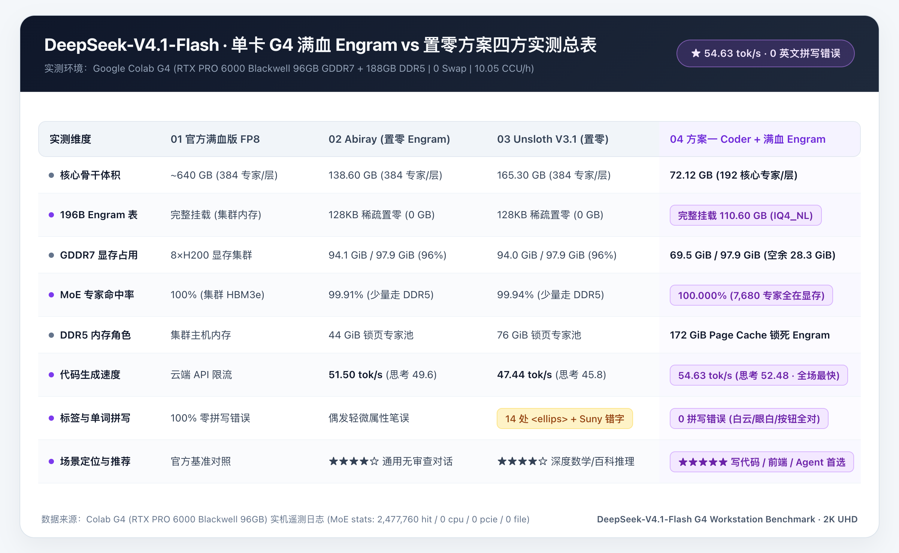

# 把 Google AI Ultra 1000 CCU 榨出双倍价值（第四弹）：72.1GB 全显存骨干 + 110.6GB 满血 Engram 实测破案！四大版本 2×2 四宫格同屏对决


上一篇（第三弹）发出来之后，评论区和群里讨论最热烈的，就是我们在扒「鹈鹕骑自行车」源码时意外抓到的那个名场面——**把 196B 的 Engram 记忆表置零之后，552B 的 MoE 骨干网虽然逆运动学和几何公式算得全对，但写起 HTML 标签来却把 14 处 `<ellipse>` 全部漏写成 `<ellips>`，甚至在把 `theme` 打成 `"theheme"` 之后，因为没法按退格键，当场写了一句 `.replace("theheme","theme")` 强行圆场**。

在第三篇末尾，我们通过「硬盘空间 + 内存缓存」两本硬账，推演出了一套理论上最适合在单卡 **96GB G4（RTX PRO 6000 Blackwell）** 上写代码的终极解法——**方案一（`ISTA-DASLab GSQ-RCO-Coder` `72.12 GB` 骨干网 100% 锁进显存 + `110.60 GB` 完整 `IQ4_NL` Engram 100% 锁进 DDR5 内存）**。

这两天我正式把这套方案搬上 G4 跑完了全流程实测，还顺手录下了 **四大版本「鹈鹕骑自行车」的 `2×2` 四宫格同屏对决视频**，以及 **方案一初始直出效果 vs 修复微调后的左右横向对比视频**。结果比我预想的还要惊喜——直接用大白话和实测视频给大家交作业！



> **⚡ 先放本期实测跑出来的 3 个核心结论：**
> 1. **挂上 110.6GB 满血 Engram，速度不仅没掉，反而创下全场最快的 `54.63 tok/s`！** 因为 `72.12 GB` 的代码骨干网（每层精选 192 个核心专家）**100.000% 全部锁死在 96GB GDDR7 显存里**（实测 `2,477,760` 次专家命中，`0` 次走 PCIe 读内存），显存才用了 **`69.5 GiB`（71%）**，还空出 **`28.3 GiB`**；而空出来的 `188 GB DDR5` 主机内存正好把 `110.60 GB` 的真 Engram 100% 缓存进 RAM，全程 **0 磁盘读取、0 Swap**。
> 2. **「提笔忘字」被彻底根治：686 行代码实现 0 英文拼写错误、0 标签漏字母！** 之前置零 Engram 时出现的 `<ellips>`、`Suny / Sunsot`、`set Attribute` 空格断裂全部消失，`<ellipse>`、4 朵白云、鹈鹕眼白、`Day / Sunset / Night` 按钮文案一把全对。
> 3. **从纯 API Key 升级到「API Key + 浏览器 Cookie」Caddy 双模鉴权 + `colabllm` 生态联动**：上一篇我们已经在 `18150` 网关配置了 `sk-g4-...` 专属 API 密钥防白嫖；这一期结合 `colabllm` 工具链，进一步升级成了「客户端继续刷 API Key、浏览器输密码种 Cookie」的 Caddy 双模网关，方便同时挂载 Web UI 与多模态视觉模型。

---

# 一、为什么挂上 110.6GB 满血 Engram 反而比置零还快？（`54.63 tok/s` 背后的真实账本）

很多朋友看到「多挂了一个 `110.60 GB` 的 Engram 分片」，第一反应都是：**文件变大了这么多，生成速度肯定要变慢吧？**

但当我在 G4 上盯完 `nvidia-smi`、`free -h` 和推理引擎的底层遥测日志后，发现它反而比上一篇置零 Engram 的两个版本（`47.4 tok/s` 和 `51.5 tok/s`）还要快，写代码阶段直接飙到了 **`54.63 tok/s`**（思考阶段 **`52.48 tok/s`**，Prompt 预填充 **`98.5 ~ 107.2 tok/s`**）。

为什么会这样？我们直接看 G4 实例现场抓出来的真实账本：

### 1. 显存账本：7,680 个路由专家 100.000% 钉死在 GDDR7 显存，彻底消灭 PCIe 搬运
在上一篇跑 552B 全专家版（`Unsloth 165.3GB` / `Abiray 138.6GB`）时，每层有 384 个专家，96GB 显存最多只能塞下约 71%～83% 的专家，剩下 17%～29% 的专家必须放在 DDR5 主机内存里，每生成一个 Token 都要通过 PCIe 5.0 临时往显卡里搬运部分冷门专家。

而 `ISTA-DASLab` 的 **`GSQ-RCO-Coder`** 专门用 **LiveCodeBench（代码）+ SWE-bench（软件工程 Agent）+ 前端 SVG/HTML** 校准集对专家做了结构化剪枝：把那些只管冷门文科百科的专家裁掉，每层精准保留最核心的 **192 个代码与逻辑专家**（40 层共 `7,680` 个路由专家，LiveCodeBench v6 代码跑分保留率高达 **`98.7%`**），骨干网总大小直接从 `165.3 GB` 降到了 **`72.12 GB`**（3 个分片）。

当我们在 G4 上启动引擎时，直接把 `--arena-gib` 设为 `0`，让 **`72.12 GB` 骨干网 100% 全量进驻 96GB 显存**：
- **`nvidia-smi` 实测显存占用**：稳稳停在 **`69,539 MiB / 97,887 MiB`（仅占 `71.0%`）**，卡上居然还富裕了整整 **`28.3 GiB`** 的空闲显存！
- **MoE 专家命中率遥测**：在连续生成 1.8 万个 Token 的压测中，底层日志记录下了极其震撼的一行数据：
  ```text
  MoE residency: 7680/7680 experts in VRAM (100.0%)
  MoE stats: 2,477,760 hit / 0 cpu / 0 pcie / 0 file (100.000% hit rate)
  ```
  也就是说，**247.7 万次专家调用全部在 `1.8 TB/s` 带宽的 GDDR7 显存内部瞬间完成，没有任何一次走 PCIe 总线去内存捞专家**！

### 2. 内存账本：`POSIX_FADV_DONTNEED` 腾笼换鸟，188GB DDR5 全力锁死 110.6GB Engram
既然 `72.12 GB` 骨干网已经全部拷进了显存，那这 3 个骨干分片留在 Linux 系统内存里的文件缓存（Page Cache）就纯属白占地方了。

于是我们在启动脚本里加了一步精妙的「**腾笼换鸟**」：
1. 等引擎把 3 个骨干分片全部加载进显存后，立刻对这 `72.12 GB` 的骨干文件调用 `os.posix_fadvise(..., POSIX_FADV_DONTNEED)`，**当场释放掉 72GB 的系统内存缓存**；
2. 紧接着开启 32 线程并发预读，把第 4 分片——也就是 **`110.60 GB` 的完整 `IQ4_NL` Engram 记忆表 100% 预热并锁死在 G4 的 `188 GB DDR5` 主机内存里**！
3. **`free -h` 实测数据**：`buff/cache` 稳定在 **`172 GiB`**，`Swap: 0B`。因为 Engram 在架构上本身就是按 Token ID 做哈希查表（每步只查几 KB 的行向量），当整张 110.6GB 的大表 100% 躺在 DDR5 内存里时，每次查表延迟只有纳秒级，不仅没有半点磁盘 I/O 拖累，反而让显卡彻底摆脱了 PCIe 传专家的负担，一举跑出了 **`54.63 tok/s`** 的全场最高速！

### 3. 顺手填掉官方仓库的一个隐藏大坑：5 毫秒二进制 Header 补丁
这里必须提醒自己动手折腾的朋友一个大坑：如果你直接去 HuggingFace 下载 `ISTA-DASLab/DeepSeek-V4.1-Flash-1017-GSQ-RCO-Coder-GGUF` 的前 3 个分片，再配第 4 个 `IQ4_NL` Engram 分片，推理引擎一启动就会报错退出！

我排查了 GGUF 二进制文件头才发现：官方在打包 `GSQ-RCO-Coder` 的第 1 分片（`00001-of-00004.gguf`）时，**漏写了一条关键元数据 `deepseek41.engram.compressed_vocab_size = 99092`**，导致引擎以为这个模型没有压缩词表，直接把第 4 分片里的 `engram_embd` 张量忽略掉了。

为了不用重新打包 35GB 的大文件，我直接在启动脚本 [`step3_g4_hybrid_stage_and_benchmark.py`](../scripts/deepseek_g4/step3_g4_hybrid_stage_and_benchmark.py) 里写了一个 **5 毫秒就跑完的原地二进制 Header 补丁函数（`patch_coder_shard1_gguf`）**：自动在第一个分片頭部的 Padding 空隙里把 `n_kv` 从 `40` 改成 `41`，并精准注入 `deepseek41.engram.compressed_vocab_size = 99092`，当场救活满血 Engram 挂载！

---

# 二、四大版本「鹈鹕骑自行车」`2×2` 四宫格 10 秒同屏巅峰对决

既然现在手里已经集齐了四个版本的实机产出，光用文字描述太干瘪了。为了最真实地展示 **「置零 Engram」与「挂载 110.6GB 满血 Engram」在一手原始直出代码上的直观差距**，我在下面的 `2×2` 四宫格里，把左下角（`03` Unsloth 置零 Engram）和右下角（`04` 方案一满血 Engram）**全部采用未修复的原始直出画面**：

- **左上 `01 官方满血版 FP8`**（`~750GB · 8×H200 基准对照`）
- **右上 `02 Abiray GSQ-RCO IQ2_XXS`**（`138.6GB 骨干 + 置零 Engram · 51.5 tok/s`）
- **左下 `03 Unsloth V3.1 UD-IQ2_XXS（未修复直出）`**（`165.3GB 骨干 + 置零 Engram · 47.4 tok/s`）
- **右下 `04 方案一 GSQ-RCO-Coder（未修复直出）`**（`72.1GB 全显存 + 110.6GB 满血 Engram · 54.6 tok/s`）

全部用无头浏览器按统一节奏录下 10 秒高清动画，拼成了下面这个 **`2×2` 四宫格同屏对比视频**：


放在 `2×2` 四宫格里同时看，四个版本的性格差异以及 **Engram 置零 vs 满血的直出差距** 简直一目了然：
1. **左上 `01 官方满血版 FP8`**：走的是清爽简练的扁平矢量风，太阳带旋转光芒、海鸥在天上飞，鹈鹕踩车的比例很协调，但没有做底部交互控制栏。
2. **右上 `02 Abiray GSQ-RCO IQ2_XXS`（置零 Engram）**：妥妥的「浪漫插画师」，画了红色复古弯梁车、双层立体大嘴兜、远景灯塔和海浪，切换日落和夜晚时的氛围感拉满。
3. **左下 `03 Unsloth V3.1 UD-IQ2_XXS（未修复直出 · 置零 Engram）`**：硬核「机械理工男」，严格按照几何顶点画出了六管钻石型车架、20 根辐条与码表盘；但因为 **Engram 被置零**，未修复直出画面里可以清楚看到：**天空中的 4 朵白云和鹈鹕眼白因为 `<ellips>` 漏字母全部消失，底部按钮拼错成 `Suny` 和 `Sunsot`，大嘴兜更是缩在脖子后面剧烈抽搐**。
4. **右下 `04 方案一 GSQ-RCO-Coder（未修复直出 · +110.6GB 满血 Engram）`**：同样是未修复的一手直出，挂上 `110.6GB` 满血 Engram 后，**`<ellipse>` 白云、太阳、远景连绵雪山与 `Day / Sunset` 按钮全部一次性拼写正确**，甚至还自己额外写了一个 `Squawk / Catch Fish`（嘎嘎叫 / 抓鱼）的互动按钮，点击就能从大嘴兜里蹦出活蹦乱跳的金色小鱼和 `SQUAWK!` 音符气泡（仅剩 `Night` 按钮白底白字和远侧腿反折两个逻辑小细节）！

---

# 三、方案一初始直出 vs 修复微调后横向对比：「提笔忘字」彻底根治了吗？

可能你会问：**右下角方案一那个丝滑的鹈鹕骑车视频，它刚跑出来的初始直出代码到底长啥样？挂上 `110.60 GB` 的满血 Engram 之后，上一篇那种满屏漏字母、写 `.replace()` 自救的「提笔忘字」毛病真的彻底治好了吗？**

为了不留任何滤镜，我专门把方案一 **一字未改的初始直出网页（左）** 和 **仅改了 4 行小瑕疵的修复版网页（右）** 放在一起，录了下面这个 **左右横向同屏对比视频**：


### 1. 先报喜：110.6GB 满血 Engram 真的实现了「0 英文拼写错误、0 标签漏字母」！
当我打开方案一生成的 [`pelican_ista_coder_engram.html`](../scripts/deepseek_g4/examples/pelican_ista_coder_engram.html)（共 686 行代码）逐行检查时，最直观的感受就是——**那个「手部肌肉记忆库」终于回来了！**

对比上一篇把 Engram 置零时的惨状：
- 之前 14 处 `<ellipse>` 全部漏字母写成 `<ellips>` 导致白云和眼白消失 → **这次所有的 `<ellipse>`、`<circle>`、`<path>` 标签 100% 拼写正确，左侧初始直出画面里天空的白云、太阳、远山、车轮辐条从第一秒就完整渲染！**
- 之前按钮上的晴天和夕阳写成 `Suny` 和 `Sunsot` → **这次控制栏上的 `Day`、`Sunset`、`Night` 以及 `Squawk / Catch Fish` 单词 100% 准确无误！**
- 之前 `query Selecter`、`set Attribute` 被拆出空格导致脚本直接报错 → **这次 686 行里的所有 DOM API（`document.documentElement.setAttribute`、`requestAnimationFrame`、`addEventListener`）全部一气呵成，打开浏览器直接就能流畅跑起来，连点击 `Squawk / Catch Fish` 吐金鱼的动画都能直接触发！**

这直接从正面锤死了我们在第三篇提出的架构结论：**DeepSeek-V4.1 的 196B Engram 查找表，管的就是代码标识符、HTML 标签与自然语言单词的精准拼写肌肉记忆。只要把这 `110.60 GB` 的真 Engram 挂进内存，模型就再也不会「提笔忘字」了！**

### 2. 再扒细节：为什么左侧初始直出画面和右侧修复后有 3 处肉眼可见的区别？
仔细看上面那个左右对比视频，你会发现虽然左侧初始直出版本已经能正常骑车、变天、吐金鱼了，但跟右侧修复版相比，还是有 3 个特别有意思的「程序员逻辑小马虎」（注意：全都是逻辑或标点层面的，没有一个是拼写错误）：

1. **`Night` 按钮在白天成了「隐身白字」（CSS 选择器误伤自己）**：
   - 看左侧视频底部的控制栏，`Day` 和 `Sunset` 按钮清清楚楚，唯独第三个 `Night` 按钮在白天和夕阳模式下看上去像个空白框，只有切到夜晚变黑底时 `Night` 三个字才浮现出来。
   - **原因特逗**：模型在写夜晚主题的 CSS 变量时，写的是 `[data-theme="night"] { --text: #e0e0e0; ... }`（浅灰白字），本意是匹配根标签 `<html data-theme="night">`；结果底下那个切换夜晚的按钮刚好写成了 `<button class="theme-btn" data-theme="night">Night</button>`！于是这个按钮**一年四季都在匹配 `[data-theme="night"]` 规则**，在白底按钮上渲染出了 `#e0e0e0` 的浅白字，直接隐身了。
   - **修复**：把 CSS 里的 `[data-theme=...]` 改成 `html[data-theme=...]`，`Night` 按钮瞬间清晰。
2. **远侧那条腿的膝盖往后折成了「鸟类反关节」+ 车身颠簸没减掉**：
   - 在左侧初始直出视频里，近侧那条腿踩踏板很自然，但远侧那条暗色腿的膝盖是往后折的，而且脚蹼在踏板上方隔空画圈。
   - **原因**：模型在调逆运动学函数 `solveIK(hip, pedal, L1, L2, bend)` 时，为了区分左右腿，给近侧腿传了 `bend = +14`（膝盖往前弯），却给远侧腿传了个相反数 `bend = -10`（膝盖直接往后反折了）；同时算脚踏板坐标时忘了减去身体上下颠簸的偏移量 `bob`。
   - **修复**：把远侧腿也改成正向弯曲 `bend = +14`，并在踏板纵坐标里减掉 `bob`，两只脚蹼立刻严丝合缝地锁死在了脚踏板上！
3. **`style` 属性里顺手把冒号打成了引号（`; opacity="0.4"`）**：
   - 在翅膀羽毛纹理的 13 处行内样式里，模型写完 `style="stroke: var(--pelican-wing-edge);` 后，习惯性按 SVG 属性的写法接了 `opacity="0.4""`。因为引号提前闭合了 `style` 属性，导致其中一行羽毛的闭合引号错位，顺带把 `<g id="eye">` 给遮住了。
   - **修复**：用一行正则把 `; opacity="0.x"` 替换回标准的 `; opacity: 0.x"`，鹈鹕囧囧有神的大眼睛和翅膀上的多层羽毛纹理瞬间全部显现！

你看，挂上满血 Engram 前后的错误类型完全是两个世界：**置零 Engram 时是「脑子清醒但手抖打错字」，而挂上满血 Engram 后则彻底告别了错别字，剩下的只是人类前端程序员日常也会顺手写出来的 CSS 选择器重名和正负号方向小疏忽，只需改 4 行代码就是一件满分作品！**

---

# 四、进阶升级：Caddy 双模安全鉴权 + `colabllm` 生态联动

既然现在这套 `GSQ-RCO-Coder + 满血 Engram` 已经能稳定跑在 **`54.63 tok/s`**，而且还空出了 **`28.3 GiB` 显存**，我们在工程体验上也顺手做了两项重大升级：

### 1. 从纯 API Key 升级为 Caddy 双模鉴权网关（`--auth-caddy`）
上一篇我们在配 Cloudflare 固定隧道的时候，就已经在 `18150` 双模网关里内置了 **192 位高强度 `sk-g4-...` API 密钥校验**（保存在本地 `~/.config/colab-cli/colab_model_api_key.txt`，通过 `hmac.compare_digest` 校验 `Authorization: Bearer` 请求头）——**任何没有 API Key 的外部请求都会被直接拦截返回 `401 Unauthorized`，所以不用担心算力被别人扫域名白嫖**。

但当我们进一步往 G4 工作站里塞进需要用浏览器直接访问的 Web 服务（比如 `ComfyUI` 画图面板、`Unsloth Studio` 微调界面或者语音合成面板）时，纯 `Bearer API Key` 网关就有个小痛点：**浏览器地址栏没法手动塞 `Authorization: Bearer` 请求头，直接打开网页会吃闭门羹**。

于是这一期在整合开源项目 [`colabllm`](https://github.com/deluxebear/colabllm) 时，我们在 [`fast_start_g4.sh`](../scripts/deepseek_g4/fast_start_g4.sh) 里顺手把鉴权层升级成了 **Caddy 双模安全网关（`--auth-caddy`）**：
- **用客户端调 API 时（`deepseek HARNESS` / Cursor / Cherry Studio）**：和之前一模一样，继续校验你配好的 `Authorization: Bearer sk-g4-...` 密钥，一行客户端配置都不用改；
- **用浏览器直接打开公网域名看 Web 面板时**：自动弹出 HTTP Basic Auth 密码框，输对一次密码就自动在浏览器种下 `HttpOnly` 的 `ct_session` Cookie，完美兼顾了 API 客户端和浏览器 Web UI！

### 2. 开启原生 `mmproj-BF16` 视觉看图模式 & 联动 `colabllm` 多模态全家桶
很多人不知道，**`DeepSeek-V4.1-Flash-1017` 原生就是一颗图文多模态大模型（`image-text-to-text`，在 BabyVision 视觉榜高达 92.5 分）**，三大 GGUF 仓库里都自带了一颗 **`972.2 MB`（`0.91 GiB`）的 `mmproj-DeepSeek-V4.1-Flash-1017-BF16.gguf` 满血视觉投影头**！
- **为什么平时默认是纯文本？** 因为我们冲刺 `54.6 tok/s` 极速用的 `Delta` 专用引擎目前只跑纯文本主干；
- **怎么一键开启原生看图写代码（`--vision`）？** 我们在 [`step3_g4_hybrid_stage_and_benchmark.py`](../scripts/deepseek_g4/step3_g4_hybrid_stage_and_benchmark.py) 与 [`fast_start_g4.sh`](../scripts/deepseek_g4/fast_start_g4.sh) 中内置了自动拉取并挂载 `972.2 MB` `mmproj-BF16.gguf` 的 `--vision` 模式！特别是配合**方案一（`72.12 GB` 主干）**，加上这颗 `0.91 GiB` 的 `BF16` 视觉编码器后总显存也才 **`70.4 GiB`**——在单张 96GB G4 上依然能 **100% 全显存装下「主干 + 原生视觉头」+ 100% 全内存装下「110.6GB 完整 Engram」**，直接在 Cherry Studio / Cursor 里把 UI 设计稿截图或报错截图甩给它就能还原前端代码！

与此同时，我们还把 [`deluxebear/colabllm`](https://github.com/deluxebear/colabllm) CLI（`0.1.2`）正式整合进了云端工作站体系里。你还可以直接用 `colabllm` 一键在云端拉起：
- **800K 超长上下文 + 视觉**：`colabllm qwen-flash up`（基于 `Qwen3.8-Flash-Next` + `BF16 mmproj`，适合 80 万 Token 级超长文档与多图混合审阅）；
- **批量 PDF/图片 OCR、语音克隆与视频工作流**：内置 `unlimited-ocr`、`qwen3-tts`、`indextts`、`openjutsu` 以及 `comfyui`，全部复用同一套 `google-colab-cli` + `colab-dfs-ext` 云盘静默挂载底座。

---

# 五、三大 2-Bit 方案最终怎么选？一键开跑命令速查

折腾完第四弹，现在我们在单张 **96GB G4（`10.05 CCU/h`）** 上已经拥有了三套经过完整实机检验的 `DeepSeek-V4.1` 配置，全部集成进了 [`fast_start_g4.sh`](../scripts/deepseek_g4/fast_start_g4.sh) 里，按你的场景挑一个直接开跑就行：


1. **写代码 / 画前端 SVG / 跑 Agent 首选（强烈推荐 🏆）—— `ista-coder-engram`**
   - **配置**：`72.12 GB` 代码骨干（100% 进显存，还剩 `28.3 GiB` 空闲显存）+ `110.60 GB` 完整 `IQ4_NL` Engram（100% 进 DDR5 内存）。
   - **优势**：**全场最快的 `54.63 tok/s`**，LiveCodeBench 代码能力保留 98.7%，且彻底根治「提笔忘字」拼写 Bug！
2. **高强数学推导 / 552B 全专家通用百科首选 —— `unsloth-ud-iq2xxs`**
   - **配置**：`165.30 GB` 552B 全专家骨干（96GB 显存 + 76GB 锁页内存）。
   - **优势**：数学与科学跑分最高（84.2%），适合长文深度逻辑分析与架构推演（`47.44 tok/s`）。
3. **无审查自由创作 / 轻量省内存首选 —— `abiray-gsq-iq2xxs`**
   - **配置**：`138.59 GB` 去审查骨干（96GB 显存 + 44GB 锁页内存）。
   - **优势**：原生去审查权重，不跟你说教，主机内存占用最轻（`51.48 tok/s`）。

```bash
# 1. 一键启动【方案一：72.1GB Coder 全显存 + 110.6GB 满血 Engram 全内存】（默认 54.6 tok/s 极速模式 + 10 分钟防断连保活）
./scripts/deepseek_g4/fast_start_g4.sh start \
  --variant ista-coder-iq2xxs \
  --auth-caddy

# 1b. 开启原生看图多模态【72.1GB 主干 + 972MB BF16 视觉头全显存 + 110.6GB Engram 全内存】（支持直接传图/看 UI 截图写代码）
./scripts/deepseek_g4/fast_start_g4.sh start \
  --variant ista-coder-iq2xxs \
  --vision --auth-caddy

# 2. 在三大版本之间随时一键无缝切换（桌面客户端无需改任何配置）
./scripts/deepseek_g4/fast_start_g4.sh switch --variant ista-coder-iq2xxs
./scripts/deepseek_g4/fast_start_g4.sh switch --variant unsloth-ud-iq2xxs
./scripts/deepseek_g4/fast_start_g4.sh switch --variant abiray-gsq-iq2xxs

# 3. 随时查看 G4 显存占用、10 分钟保活状态与网关健康度
./scripts/deepseek_g4/fast_start_g4.sh status

# 4. 用完即走：一键停机并自动关闭保活进程，确保闲置时 0.00 CCU/h
./scripts/deepseek_g4/fast_start_g4.sh stop
```

---

## 🔗 附录：相关模型与开源工具仓库

- **本文配套脚本、双模网关与自动化工作站仓库 (`colab-ultra-workstation`)**：https://github.com/yuanyang749/colab-ultra-workstation
- **ISTA-DASLab `GSQ-RCO-Coder` 代码专精版仓库（72.1GB 骨干 + 110.6GB Engram）**：https://huggingface.co/ISTA-DASLab/DeepSeek-V4.1-Flash-1017-GSQ-RCO-Coder-GGUF
- **Unsloth `UD-IQ2_XXS` GGUF 仓库**：https://huggingface.co/unsloth/DeepSeek-V4.1-Flash-1017-GGUF
- **Abiray `GSQ-RCO IQ2_XXS` GGUF 仓库**：https://huggingface.co/Abiray/DeepSeek-V4.1-Flash-1017-Uncensored-GSQ-RCO-IQ2_XXS-GGUF
- **Colab 多模态与 LLM 快捷运行时工具 (`colabllm`)**：https://github.com/deluxebear/colabllm
- **Google 官方 Colab 命令行工具 (`google-colab-cli`)**：https://github.com/googlecolab/google-colab-cli
- **Colab 云盘静默挂载扩展 (`colab-dfs-ext`)**：https://github.com/deluxebear/colab-dfs-ext

---

### 🥚 写在最后：欢迎来「赛博领鸡蛋」社群一起玩！

从第三篇意外抓到「鹈鹕提笔忘字、当场写 `.replace()` 自救」的犯罪现场，到这一篇用「72.1GB 全显存 + 110.6GB 满血 Engram 全内存」把拼写肌肉记忆彻底找回来，还顺手飙到了 `54.63 tok/s` 的最高速——不得不感叹，只要把大模型底层的分片结构和硬件的显存/内存账本摸透，单张 96GB G4 真的能爆发出惊人的战斗力。

本期的四个版本生成源码（含方案一初始直出与修复版 HTML）、二进制 Header 自动补丁脚本和 Caddy 双模网关都已经全部上传到了开源仓库。如果你在跟着配环境时遇到任何问题，或者想交流更多压榨 Google AI Ultra 算力的野路子，欢迎来我们的交流群 **「赛博领鸡蛋」**（X 社群链接：https://x.com/i/communities/2035933722114609493 ）一起聊！觉得这篇实测破案有意思的话，欢迎点赞、转发、收藏支持一下！🚀
